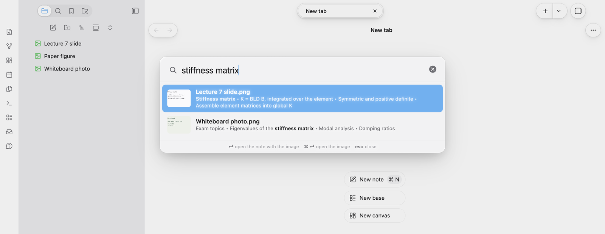

# Tahoe OCR

**Search the text in your images.** Screenshots, photos of slides and whiteboards, and scanned pages are read on your Mac with macOS's own text recognition (the engine behind Live Text). Find an image by the words in it, copy its text, and, if you like, let Obsidian's search find it too.



- **Search text in images** (command palette): type a few words and pick the image. Enter opens the note that shows it, ⌘Enter the image itself.
- **Copy text from image**: in an image's menu in the file list.
- **Searchable index note** (optional): a note listing the text of each image, so Obsidian's own search and links find it.

New and changed images (PNG, JPEG, GIF, WebP, HEIC, TIFF and BMP) are read in the background as they arrive. The text is kept with the vault, so on iPhone and iPad the search works too; reading new images needs the Mac.

## Using it

1. Install it from Settings → Community plugins → Browse → "Tahoe OCR", and turn it on.
2. On your Mac, it starts reading the images in your vault. The status bar shows its progress.
3. Run **Search text in images** from the command palette.

Files you've excluded in Settings → Files and links are left out, the same way search leaves them out. **Read text in all images again** (command palette, on the Mac) starts over.

<!-- tahoe-family -->
## The Tahoe family

Tahoe is a set of plugins and a theme that work on their own and fit together.

| | | |
| --- | --- | --- |
| **[Tahoe Run](https://github.com/krishnanefx/obsidian-tahoe-run)** | Run the code in your notes, like a notebook: Python with a debugger and variables view, MATLAB, and ~25 other languages. | available |
| **[Tahoe Math](https://github.com/krishnanefx/obsidian-tahoe-math)** | A calculator in your notes: type an expression ending in `=` and the answer appears. | available |
| **[Tahoe](https://github.com/krishnanefx/obsidian-tahoe-theme)** | A clean, Mac-like theme, in light and dark. | available |
| **[Tahoe Code](https://github.com/krishnanefx/obsidian-tahoe-code)** | An IDE in your code blocks: suggestions, checking as you type, quick fixes, go to definition, formatting and AI edits. | available |
| **[Tahoe Glass](https://github.com/krishnanefx/obsidian-tahoe-glass)** | Real refraction for the Tahoe theme's glass, and header cards on settings pages. | available |
| **[Tahoe Organize](https://github.com/krishnanefx/obsidian-tahoe-organize)** | Keep a growing vault tidy: inbox triage, smart folders, colored tags, link suggestions, vault health, literature notes and text from images. | available |
| **[Tahoe Intelligence](https://github.com/krishnanefx/obsidian-tahoe-intelligence)** | On-device AI for your notes: ask your notes, related notes, distilling permanent notes and more. | available |
| **Tahoe OCR** | Search the text in your images: screenshots, slides and scanned pages, read on your Mac. | this one |

**Better together**

- **With [Tahoe Organize](https://github.com/krishnanefx/obsidian-tahoe-organize):** Organize's "Text from images" is the same reader. With it on, Tahoe OCR searches Organize's index instead of reading every image twice, so you only need one of them for this.
<!-- /tahoe-family -->

## Feedback

Questions are welcome in [Discussions](https://github.com/krishnanefx/obsidian-tahoe-ocr/discussions), and bugs and ideas in [Issues](https://github.com/krishnanefx/obsidian-tahoe-ocr/issues/new/choose). If Tahoe OCR is useful to you, a star helps others find it.

## Disclosures

- **Network use:** none. Images are read on your Mac, and nothing is sent anywhere.
- **It runs programs on your Mac** (desktop only): if Xcode's command line tools are installed, it builds a small helper with them once (`xcrun swiftc`) and runs it to read images; otherwise it uses AppleScript (`osascript`). Both use macOS's own text recognition, on your Mac.
- **Files outside your vault:** the helper is kept in `~/Library/Caches/tahoe-ocr`, and the AppleScript in your system's temp folder.
- **Files in your vault:** the text of each image is saved in the plugin's folder (`image-text.json`), and in the index note if you turn it on.
- **Clipboard:** it writes to the clipboard only when you choose *Copy text from image*.
- **No telemetry, ads, accounts or payments.**

Tahoe OCR isn't affiliated with, or endorsed by, Apple.

## License

[MIT](LICENSE) © 2026 Krishnan Adaikkappan

## Building from source

```sh
npm ci
npm run build     # writes main.js
```

Releases are built by GitHub Actions: push a tag that matches the version in `manifest.json`, then publish the draft release it creates.
